# Workout builder quality of life review

Baseline: `433784a42287a8d7049b8df5de4fca6a9a00bbad`. Proposed code: `67232963dec54f2657b64ccc5f2b9088c154b24d`.

One PR, two implementation batches. Routine workflow and accessibility improvements reuse existing CVF controls, typography and tokens; this does not introduce a new visual identity direction.

## Batch 1

- Show clearer Reps / Time / Distance / Time + distance choices. Quick workouts expose the choice before More; reps are visibly optional.
- Create an unmatched exercise in the catalog directly under its name, preserving the workout prescription. The action reuses normalized existing names, propagates new entries to parent lists, coalesces same-session repeated requests and stops before mutation if its originating editor/session ends. Hidden entries must be made available in the catalog first.
- Warn before losing edits through editor selection, dialog close, builder tabs, route navigation, browser Back, reload, or import-source switching. Explicitly discarded quick drafts reset.

## Batch 2

- Undo removal restores only that exercise, preserving subsequent changes in other fields and rows.
- Phone summaries show prescribed reps/time/distance and rest without opening each exercise.
- Quick workouts can duplicate complete prescriptions and move rows up/down.
- Unit changes retain the existing number, show the resulting value, and offer explicit conversion to preserve physical time/distance. Conversion rounds downward to avoid exceeding strict metric maxima.

## Verification

| Check | Result |
| --- | --- |
| Frontend unit suite | 135 passed |
| New behavior and paired-capture run | 17 passed (11 behavior checks + 6 proposed captures) |
| Baseline captures | 6 passed; all 12 before/after images inspected |
| Baseline regression proof | All 3 first-batch tests failed for their intended missing features on baseline source |
| Full preview run | 106 passed, 14 skipped, 3 stale-expectation failures |
| Corrected regression rerun | 4 passed: pending-save switch, pending-save return, desktop copy, phone copy. Existing save/copy checks retained; assertions now handle the explicit discard warning and × summaries. No unresolved failures from the full run. |
| Production build | Passed; existing large-chunk warning remains |
| HTML comparison | Rendered, all 12 images loaded, no horizontal overflow; pixels inspected |
| Diff whitespace | Passed |

The full preview command was not rerun after correcting those three expectations; the affected cases and the related return-during-save case were rerun together. Live-auth cases remain skipped without dedicated test credentials. Preview verifies UI behavior, not hosted authentication or database writes.

The local browser required a temporary executable outside the repository because the normal browser download was unavailable. No dependency, lockfile, production setting or test default was changed for that workaround.

## Boundaries

Frontend only; existing catalog and workout endpoints, authorization, schemas and production data are unchanged. No hosted migration, merge, production deployment or test-account creation was performed.

Creating an exercise persists it to the catalog immediately, independently of saving the workout. Draft bodies remain in memory; this is a discard warning, not draft autosave. Browser unload warnings depend on platform support.

The existing catalog API does not enforce global normalized-name uniqueness. Same-session repeated inline actions share one request, and each new request refreshes the catalog, but simultaneous creates on separate devices/processes can still duplicate names. A global uniqueness contract would need separate backend/schema work.

## Visual comparison

See [HTML comparison](index.html) and [capture manifest](manifest.json). Both sources use the same fictional coach data, dark theme, viewport and logical action/scroll sequence. Added content can change the physical scroll position.

| Surface | Before | After |
| --- | --- | --- |
| Workout 320px | 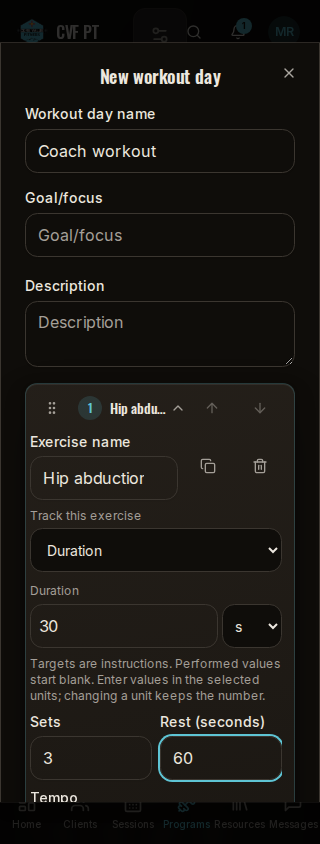 | 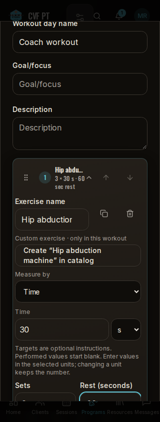 |
| Workout 390px | 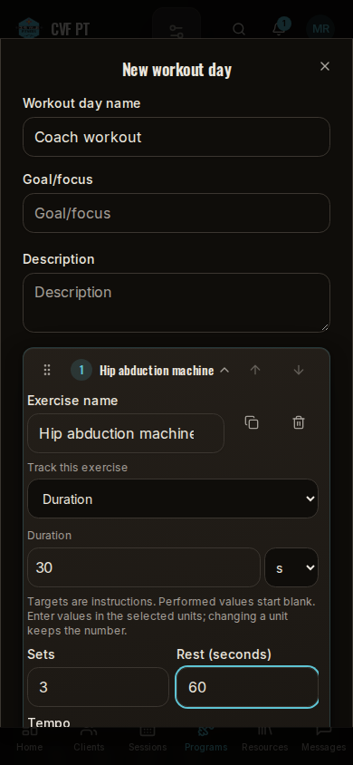 | 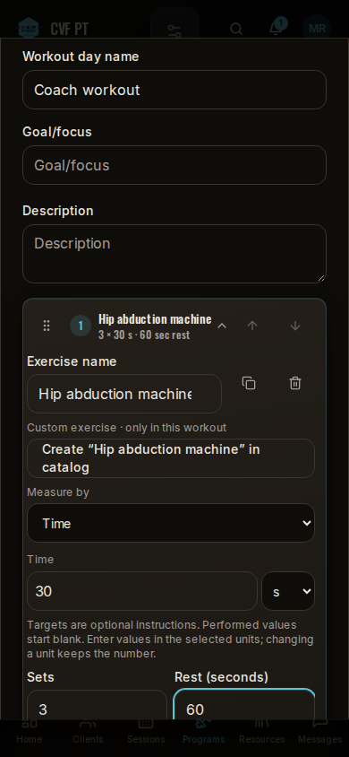 |
| Workout 1440px | 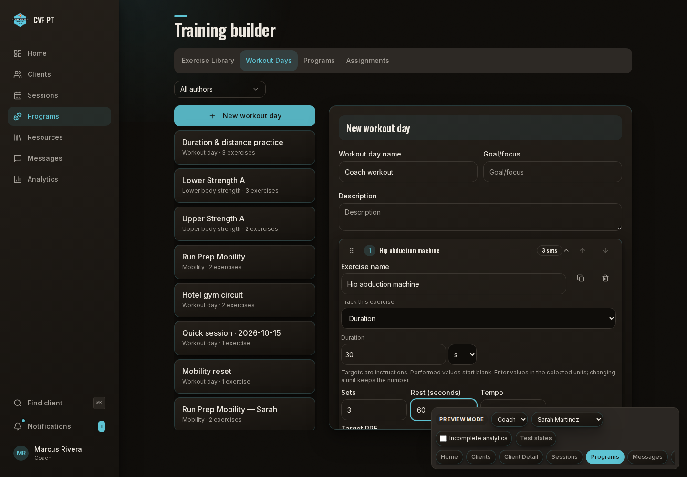 | 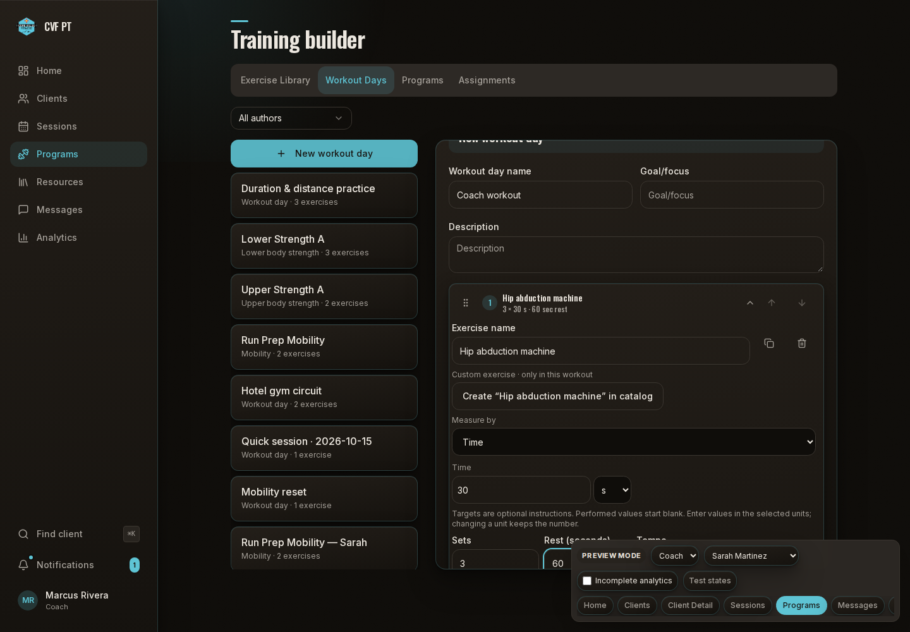 |
| Quick 320px | 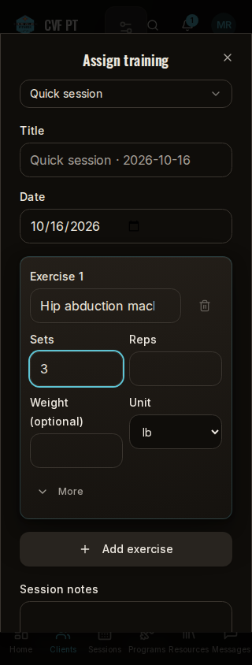 | 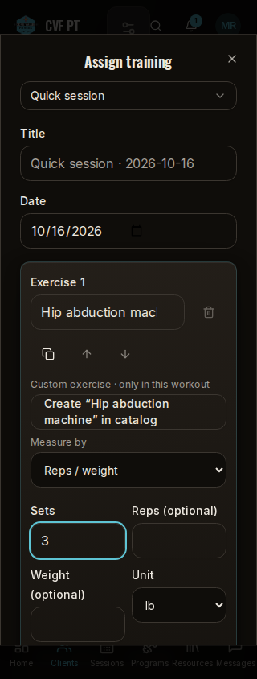 |
| Quick 390px | 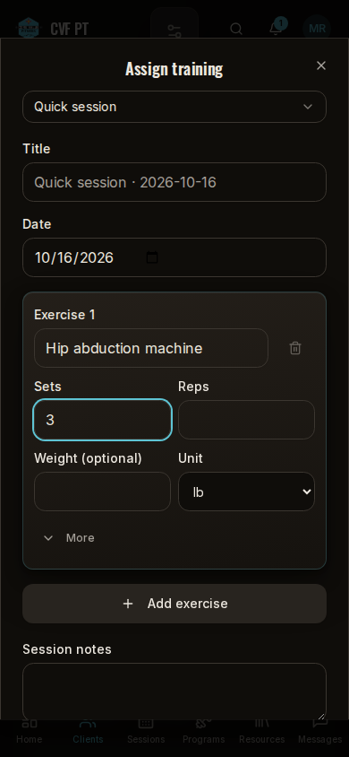 | 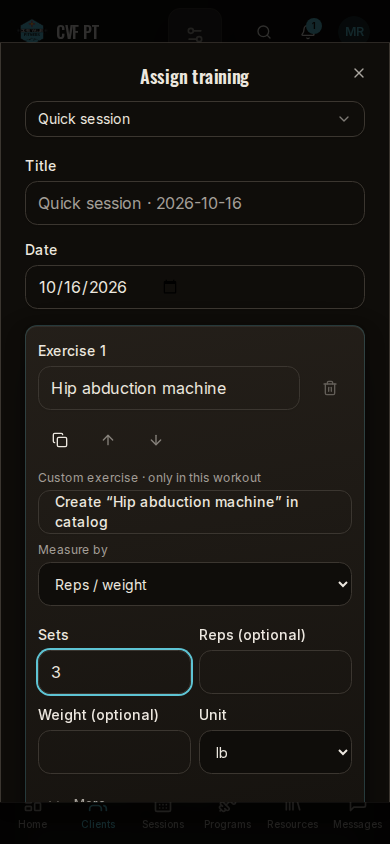 |
| Quick 1440px | 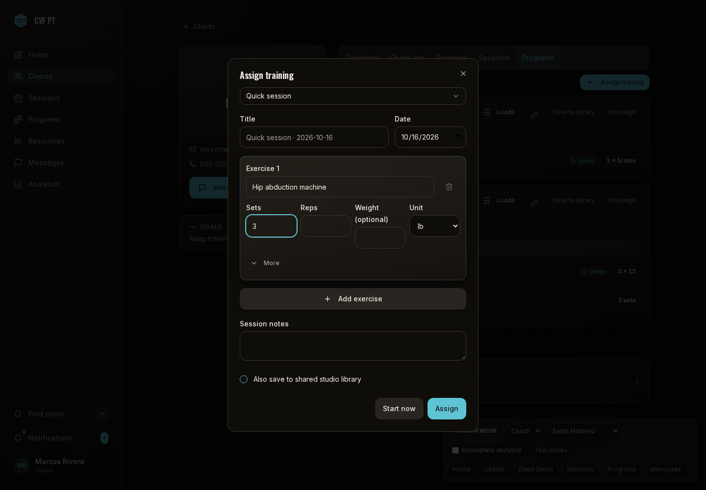 | 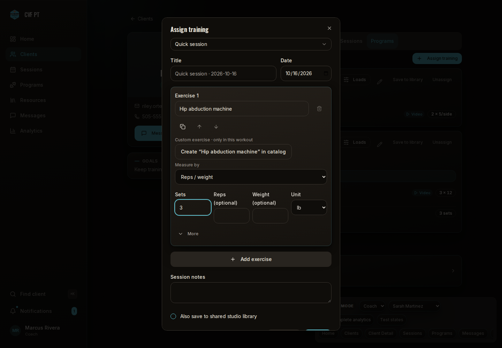 |
